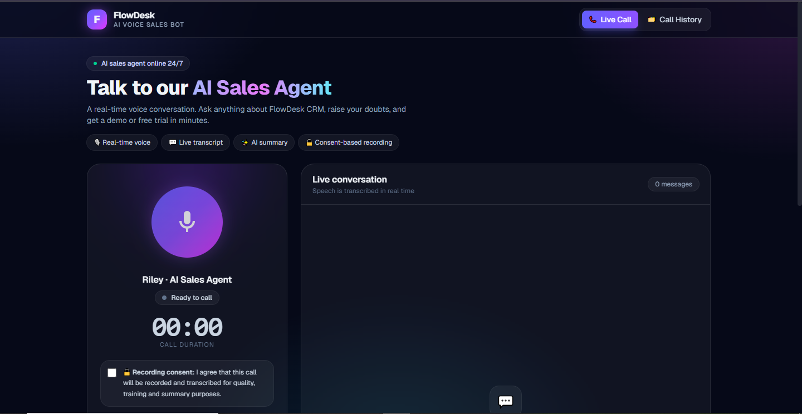
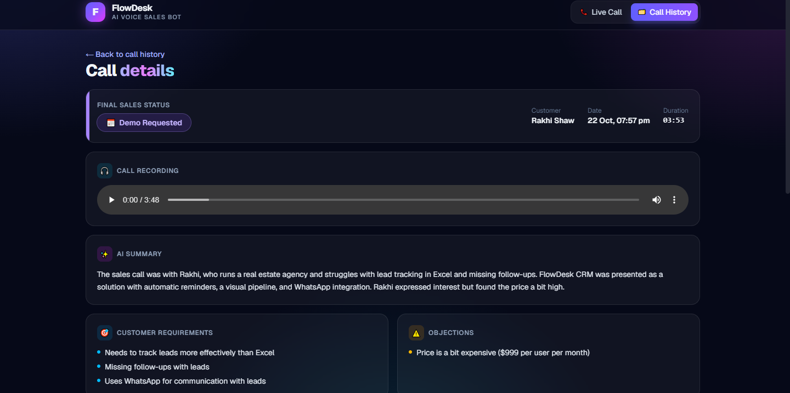
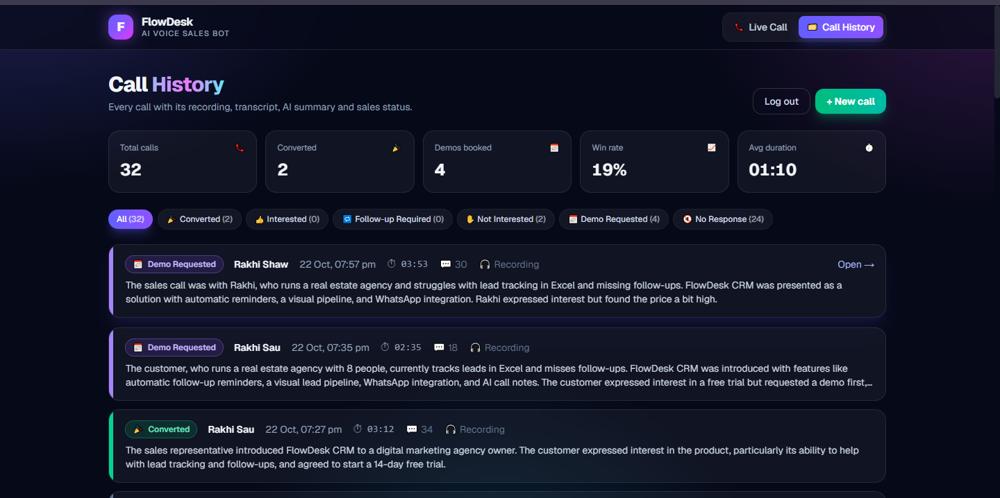
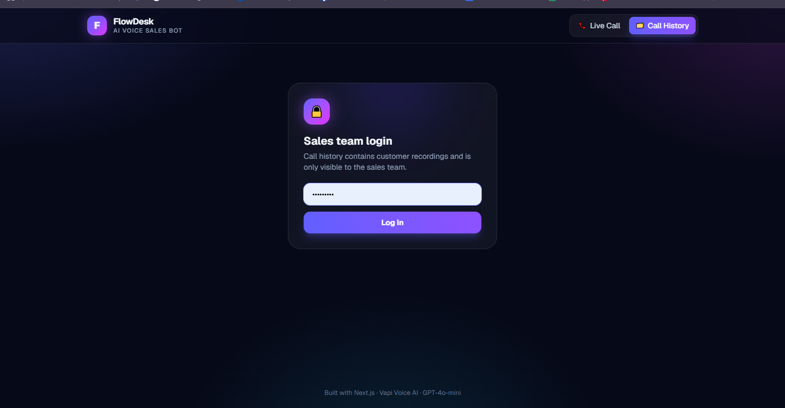

# AI-Voice-Sales-Agent-Case-Study

# AI Voice Sales Agent – Case Study

## Overview

An AI-powered voice sales agent built for a client's SaaS CRM product. Customers talk to the AI sales rep in a live, real-time voice conversation directly in the browser. The agent:

- Greets the customer and informs them that the call is recorded
- Asks about their business, team size and current workflow
- Pitches the product features that match the customer's needs
- Handles common objections such as price, timing, competitors or needing approval
- Closes for a free trial or a live demo and confirms the customer's email address

After every call, the system saves the recording, the full transcript and an AI-generated sales report. The sales team reviews all calls in a private Call History dashboard.

## Project Type

AI Voice Application – Client Project

## Business Category

SaaS Sales Automation / CRM

## Key Features

- Real-time AI voice call in the browser, with no phone line needed
- Live transcript of the conversation
- Sales-focused conversation flow: discovery, pitch, objection handling, close
- Accurate email capture, with the agent spelling the address back to confirm it
- Speech recognition tuned for Indian English and Hinglish
- AI-generated call summary, customer requirements, objections and next steps
- Automatic sales status for each call (Converted, Demo Requested, Interested, Follow-up Required, Not Interested, No Response)
- Consent-based call recording
- Secure recording playback
- Password-protected Call History dashboard for the sales team
- Microphone check and troubleshooting guidance
- Auto hang-up on long silence
- Responsive modern UI

## Tech Stack

- Next.js
- React
- Tailwind CSS
- Vapi (Voice AI)
- OpenAI GPT-4o-mini
- Soniox Speech-to-Text
- LiveKit
- Vercel

## My Role

- Designed the sales call flow and AI agent behaviour
- Wrote the system prompt and conversation guardrails
- Built the complete front end: live call screen, transcript, call result and history dashboard
- Integrated the voice AI platform for calling, recording and post-call analysis
- Designed the structured AI report and sales status logic
- Tuned speech recognition for Indian English speakers
- Implemented the admin login and secure recording access
- Tested and deployed the application

## Screenshots

### Live Call Screen

### Live Transcript

### Call Result & AI Summary

### Call History Dashboard

### Call Detail

### Admin Login

## Status

Completed and delivered to the client.

## Confidentiality Note

This is a client project. Source code, API keys, live links, call recordings and customer data are not shared. This repository is a case study only, showing the features, my role and screenshots of the work.
